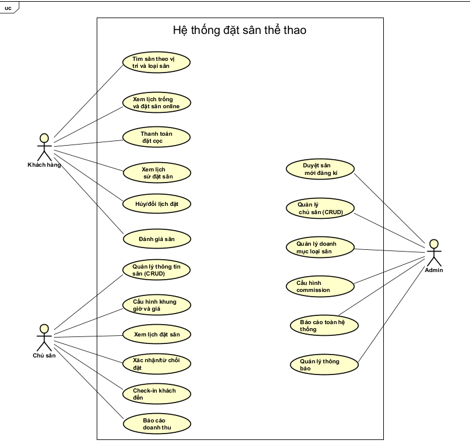

# Sports Facility Booking System - Requirements

## Actors
Hệ thống có 3 tác nhân chính:

- Khách hàng
- Chủ sân
- Admin

## Functional Requirements

### 1. Khách hàng:
- Tìm sân theo vị trí và loại sân
- Xem lịch trống và đặt sân online
- Thanh toán đặt cọc
- Xem lịch sử đặt sân
- Hủy/đổi lịch đặt
- Đánh giá sân

### 2. Chủ sân:
- Quản lý thông tin sân (CRUD)
- Cấu hình khung giờ và giá
- Xem lịch đặt sân 
- Xác nhận/từ chối đặt
- Check-in khách đến
- Báo cáo doanh thu

### 3. Admin:
- Duyệt sân mới đăng ký
- Quản lý chủ sân (CRUD)
- Quản lý danh mục loại sân
- Cấu hình commission
- Báo cáo toàn hệ thống
- Quản lý thông báo

## UseCase Diagram

  

